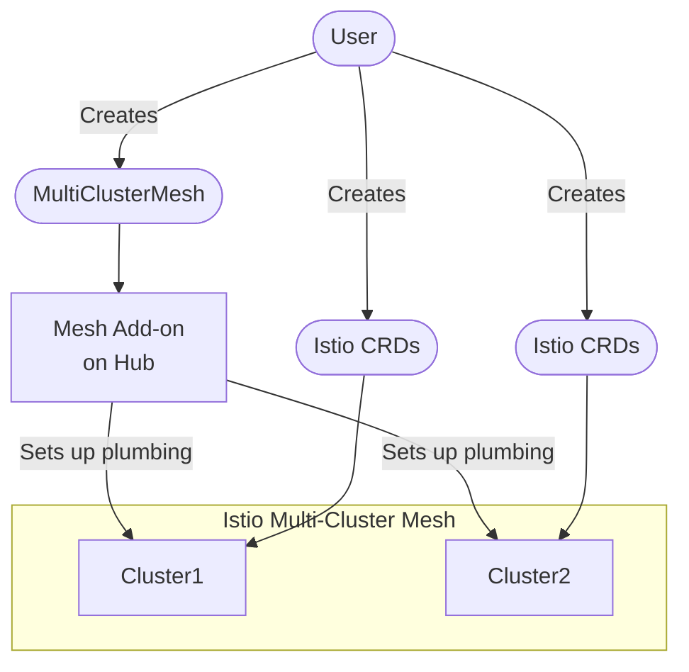

# Architecture

The addon runs on an [OCM] hub cluster and automates [multi-cluster Istio service mesh setup][multi-cluster] across managed clusters.

The service mesh operator (Sail or OSSM) is a prerequisite that the user installs separately, for example via [OperatorPolicy] from the governance-policy-framework.

## What the Addon Does

The addon manages the "plumbing" (trust and connectivity) while you configure the mesh control plane using the Istio CRDs.

- **Control Plane Namespace**: Creates an auto-derived, unique namespace per mesh on each managed cluster
- **Trust Distribution**: Mints per-cluster intermediate CAs from a shared root using [cert-manager], implementing Istio's [Plug-in CA] pattern for mTLS trust
- **Endpoint Discovery**: Exchanges discovery credentials via [ManagedServiceAccount] with appropriate RBAC to each service account, and distributes remote secrets to all peer clusters

For a detailed resource-level diagram, see the [design doc](dev/design.md#architecture).

## Cluster Selection

The addon uses OCM [Placement] for cluster selection.
The user creates a `Placement` resource in the same namespace as the `MultiClusterMesh`, and the mesh references it via `spec.placementRef.name`.
The addon reads the resulting `PlacementDecision` resources to determine which clusters to target.

This gives the user full control over cluster selection using Placement's rich predicate and scheduling capabilities (label selectors, cluster sets, tolerations, priority-based scheduling, etc.).

## Supported Topologies

The addon supports the [Multi-Primary Multi-Network] topology, in which each cluster runs its own control plane.

<!-- Reference links -->
[cert-manager]: https://cert-manager.io/
[ManagedServiceAccount]: https://open-cluster-management.io/docs/getting-started/integration/managed-serviceaccount/
[multi-cluster]: https://istio.io/latest/docs/setup/install/multicluster/
[Multi-Primary Multi-Network]: https://istio.io/latest/docs/setup/install/multicluster/multi-primary_multi-network/
[OCM]: https://open-cluster-management.io/
[OperatorPolicy]: https://open-cluster-management.io/docs/governance/policy/policy-operator/
[Placement]: https://open-cluster-management.io/docs/concepts/cluster-inventory/placement/
[Plug-in CA]: https://istio.io/latest/docs/tasks/security/cert-management/plugin-ca-cert/
