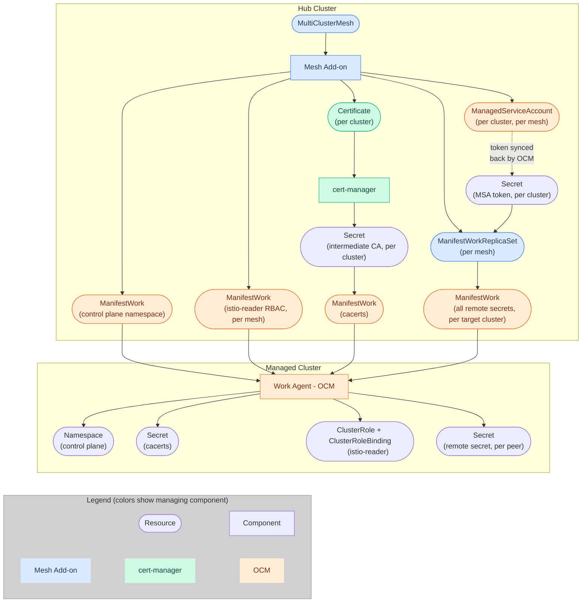

# Design

> This document describes the **target design**, not the current implementation.
> See the [Phased Approach](#phased-approach) section for implementation status.

## Table of Contents

- [Overview](#overview)
- [Architecture](#architecture)
- [Scope](#scope)
- [Supported Topologies](#supported-topologies)
- [Custom Resource](#custom-resource)
- [Cluster Selection](#cluster-selection)
- [Operator Lifecycle](#operator-lifecycle)
- [Control Plane Namespace](#control-plane-namespace)
- [Trust Distribution](#trust-distribution)
- [Endpoint Discovery](#endpoint-discovery)
- [Lifecycle Events](#lifecycle-events)
- [Phased Approach](#phased-approach)

## Overview

The OCM Service Mesh Add-on automates multi-cluster Istio service mesh setup via [OCM]. It manages the `MultiClusterMesh` custom resource on the hub cluster to orchestrate two concerns across managed clusters:

1. **Trust Distribution** - Establishing mTLS trust via [cert-manager]
2. **Endpoint Discovery** - Exchanging discovery credentials via [ManagedServiceAccount]

The service mesh operator (Sail or OSSM) is a prerequisite that the user installs separately, for example via [OperatorPolicy] from the governance-policy-framework.

Without this add-on, multi-cluster mesh setup is a manual process involving certificate management and O(N^2) secret exchanges.

## Architecture

The add-on follows OCM's hub-and-spoke model:

- **Hub**: The Mesh Add-on controller watches `MultiClusterMesh` resources and creates [ManifestWorks][ManifestWork], orchestrates cert-manager and ManagedServiceAccount
- **Spoke** (managed clusters): Receives ManifestWorks from the hub, runs the service mesh operator and Istio control plane

A [ClusterManagementAddOn] resource is deployed to register this addon with OCM's addon manager, but the addon uses manual installation strategy and does not leverage the framework's lifecycle management features (auto-deployment, per-cluster enable/disable via `ManagedClusterAddOn`).




## Scope

### What the add-on does (Plumbing)

- Creates the control plane namespace on managed clusters (auto-derived, unique per mesh)
- Distributes intermediate CA certificates for mTLS trust
- Exchanges discovery tokens between peer clusters
- Handles lifecycle events (cluster add/remove, mesh creation/deletion)

### What the add-on does not do (Configuration)

- Does not install the service mesh operator (the user installs it via [OperatorPolicy] or equivalent)
- Does not create or manage Istio custom resources (the user or GitOps owns this)
- Does not patch existing Istio CRs on spoke clusters (this would conflict with ArgoCD/GitOps reconciliation)
- Does not enforce control plane version consistency across clusters
- Does not deploy monitoring, observability, or application workloads
- Does not create AuthorizationPolicies or other application-level security config
- Does not integrate with ACM addon lifecycle (enable/disable via `ManagedClusterAddOn` and such)
- Does not adopt pre-existing mesh deployments (brownfield)

## Supported Topologies

The MVP supports the [Multi-Primary Multi-Network] mesh topology. This aligns with OCM's model where each cluster runs its own control plane. Support for other topologies (e.g., Primary-Remote, External Control Plane) can be added with backwards-compatible API changes.

### Network Partitioning

In a multi-network mesh, each cluster's control plane namespace must be labeled with `topology.istio.io/network` so that istiod knows which network the cluster belongs to.
The controller reads this label from the `ManagedCluster` object on the hub.
If the label is not set, the controller falls back to using the cluster name as the network identifier.

```bash
kubectl label managedcluster cluster1 topology.istio.io/network=network-a
kubectl label managedcluster cluster2 topology.istio.io/network=network-b
```

## Custom Resource

`MultiClusterMesh` is a namespaced resource. The namespace provides tenant isolation on the hub.
The resource name (`metadata.name`) must be a DNS label: lowercase alphanumeric characters or `-`, starting and ending with an alphanumeric character, and at most 63 characters.
Custom resource names are otherwise DNS subdomains, which allow dots, but this name is embedded in the control plane namespace.
The mesh name is also the SPIFFE trust domain, so the trust domain is limited to a DNS label as well.

### Key Fields

| Field | Required | Description |
|-------|----------|-------------|
| `spec.placementRef.name` | Yes | Name of the [Placement] defining cluster membership. Must be in the same namespace as the mesh. |
| `spec.security.trust.certManager.issuerRef.name` | No | cert-manager Issuer name for Root CA |
| `spec.security.trust.certManager.issuerRef.kind` | No | Kind of the cert-manager issuer (`Issuer` or `ClusterIssuer`, default: `Issuer`) |
| `spec.security.discovery.tokenValidity` | No | ManagedServiceAccount token lifetime (default: `360h`, minimum value: `10m`) |
| `status.controlPlaneNamespace` | (status) | Auto-derived control plane namespace (see [Control Plane Namespace](#control-plane-namespace)) |

### Example

```yaml
apiVersion: mesh.open-cluster-management.io/v1alpha1
kind: MultiClusterMesh
metadata:
  name: prod-mesh
  namespace: mesh-team-a
spec:
  placementRef:
    name: mesh-placement
  security:
    trust:
      certManager:
        issuerRef:
          name: mesh-root-issuer
          kind: Issuer
    discovery:
      tokenValidity: "168h"
```

## Cluster Selection

The add-on uses OCM [Placement] for cluster selection. The user creates a `Placement` resource in the same namespace as the `MultiClusterMesh`, and the mesh references it via `spec.placementRef.name`. The controller reads the resulting [PlacementDecision] resources (labeled with `cluster.open-cluster-management.io/placement={name}`) to determine which clusters to target.

This design gives the user full control over cluster selection using Placement's rich scheduling capabilities: label selectors, cluster sets, tolerations, priority-based scheduling, spread policies, etc. The add-on is agnostic to how clusters are selected - it simply reads the decisions.

Multiple meshes can target overlapping clusters. Their certificates, discovery tokens, RBAC, and control plane namespaces are scoped to their hub namespace/name identity. Trust domains are derived only from the mesh name, so meshes with the same name in different hub namespaces share a trust-domain string. Separate resource identities alone do not provide workload trust or service-discovery isolation; users configure issuers and Istio discovery selectors accordingly.

Plumbing resources (ManifestWorks, ManagedServiceAccounts, Certificates) use a deterministic naming strategy scoped to the owning mesh, so that multiple meshes on the same cluster don't collide.

The controller lists decisions by Placement-name label in the mesh namespace and sorts their cluster names. It compares the raw entry count with `Placement.status.numberOfSelectedClusters`; a mismatch requeues after 2 seconds without creating, updating, or deleting mesh resources. 

Selected names and resolved ManagedCluster objects are tracked separately. Resource creation and remote-secret content use resolved objects. Cleanup and status pruning use the selected names, preserving resources for a missing ManagedCluster until its name leaves the decisions. Readiness uses the resolved objects, so a partially missing selection is not currently reflected as an unready member.

Placement and PlacementDecision events enqueue meshes using a namespace-scoped field index on `spec.placementRef.name`. ManagedCluster events find affected meshes from their labeled ManifestWorks. The addon also watches mesh-labeled Secrets and ManagedServiceAccounts, addon-managed ManifestWorks, and generation changes to owned Certificates. It does not watch ManifestWorkReplicaSets directly.

## Operator Lifecycle

The service mesh operator (Sail or OSSM) is a **prerequisite** that the user installs before creating a `MultiClusterMesh`. The add-on does not manage operator installation.

The recommended approach is to use [OperatorPolicy] from the OCM governance-policy-framework. This gives the user full control over operator versions, upgrade channels, and approval modes, while ACM handles distribution to managed clusters via the same Placement-based targeting.

See [samples/operator-policy-sail.yaml](../../samples/operator-policy-sail.yaml) and [samples/operator-policy-ossm.yaml](../../samples/operator-policy-ossm.yaml) for ready-to-use examples.

### Why externalized

The operator is a cluster-scoped singleton shared across meshes. Managing it inside the add-on introduced complex collision detection (between meshes and with pre-existing operator installations) and tightly coupled the add-on to OLM internals. Externalizing it to OperatorPolicy:

- Eliminates inter-mesh operator conflict detection
- Gives the user explicit control over operator versions and upgrade policies
- Leverages ACM's policy engine for compliance reporting and remediation
- Decouples the add-on from OLM, making it work with any operator installation method

## Control Plane Namespace

The control plane namespace is auto-derived from the mesh identity using a deterministic formula:

```
istio-system-{meshName truncated to 39 characters}-{SHA-256(meshNamespace/meshName)[:10]}
```

The mesh name is cut at 39 characters so the full namespace stays within 63 characters.

The formula provides:

- The result is always at most 63 characters (Kubernetes namespace name limit)
- The result is a DNS label
- The hash includes both the hub namespace and name, so same-name meshes in different namespaces normally receive different spoke namespaces
- No user-configurable control plane namespace

The derived namespace is reported in `status.controlPlaneNamespace` after the first reconciliation.

The controller creates the namespace on each managed cluster via ManifestWork.
The namespace is labeled with `topology.istio.io/network` (the cluster's network identity for istiod, see [Network Partitioning](#network-partitioning)) and with `mesh.open-cluster-management.io/mesh-name` and `mesh.open-cluster-management.io/mesh-namespace` for identification.

The namespace ManifestWork is owned by the mesh, not shared across meshes.
Deleting the mesh deletes the namespace and everything in it on the spoke, including any Istio control plane resources the user deployed there.
Users should be aware that removing a mesh will clean up the entire control plane namespace on each cluster.

## Trust Distribution

Trust distribution requires [cert-manager] to be installed on the hub cluster. The user is responsible for setting up cert-manager and creating the `Issuer` or `ClusterIssuer` resource that acts as the Root CA.

The add-on implements Istio's [Plug-in CA] pattern:

1. A cert-manager `Issuer` or `ClusterIssuer` acts as the Root CA (user-provisioned)
2. The add-on creates per-cluster `Certificate` resources, yielding intermediate CAs
3. Intermediate CAs are distributed to managed clusters as `cacerts` secrets in the control plane namespace
4. The root CA private key never leaves the hub

The trust domain is derived from the mesh name (one trust domain per mesh, not per cluster).
Because the mesh name must be a DNS label, the trust domain cannot contain dots. A value such as `cluster.local` is not a valid mesh name.
The controller encodes the trust domain in the certificate's subject organization and SPIFFE URI, with the CN set to `Istio CA`.
The user must configure the matching `trustDomain` in their Istio CR.
All clusters in a mesh share the same trust domain, so workloads can authenticate across clusters without additional configuration.

Certificate rotation is handled automatically by cert-manager. Updated certificates are propagated to clusters when they change.

Deleting a Certificate does not explicitly delete its hub Secret. cert-manager retains that Secret by default; installations using `--enable-certificate-owner-ref` can garbage-collect it with the Certificate. Reselecting a cluster can reuse valid retained material and does not guarantee a fresh intermediate CA. See [cert-manager Secret cleanup][cert-secret-cleanup].

### Readiness

When trust is configured, the mesh does not become `Ready` until the cacerts ManifestWork is confirmed `Applied` and `Available` on every managed cluster. This prevents istiod from starting before the intermediate CA is in place (which would cause it to fall back to a self-signed CA, breaking cross-cluster mTLS). Each cluster reports a per-cluster `TrustDistributed` condition with reason `CacertsApplied` or `CacertsPending`.

## Endpoint Discovery

For multi-primary mesh topologies, each control plane needs API access to its peers. The add-on automates this using [ManagedServiceAccount]:

1. Creates a `ManagedServiceAccount` per cluster per mesh, yielding short-lived tokens and a `ServiceAccount` on the clusters.
2. Grants each `ServiceAccount` on each cluster an istio-reader `ClusterRole` and `ClusterRoleBinding` (per-mesh, cleaned up with the mesh) so it has the read permissions Istio's remote endpoint discovery needs
3. Constructs kubeconfig-style remote secrets from these tokens
4. Distributes remote secrets to all peer clusters in the mesh via [ManifestWorkReplicaSet], using the same Placement referenced by the mesh
5. Token rotation is handled automatically by the OCM platform
6. When a cluster is removed from the mesh, its MSA is deleted and its remote secrets are removed from all peers

## Lifecycle Events

- **Scale Up**: When a new cluster is selected by the Placement, the controller provisions the mesh plumbing for it: the control plane namespace, an intermediate CA Certificate when an issuer is set, istio-reader RBAC, a ManagedServiceAccount, and remote secrets for the current members. This is the same process as the initial mesh bootstrap, applied to the new cluster.
- **Scale Down**: When a cluster leaves the decisions and the raw decision-entry count matches `status.numberOfSelectedClusters`, reconciliation requests deletion of its mesh ManifestWorks, intermediate CA Certificate, and ManagedServiceAccount, and rebuilds the ReplicaSet without its remote secret. OCM applies those changes asynchronously.
- **Empty selection**: When the Placement exists and `status.numberOfSelectedClusters` agrees with the PlacementDecisions that zero clusters are selected, the same cleanup runs for every cluster. Control plane namespaces, intermediate CA Certificates, cacerts, ManagedServiceAccounts, and remote secrets are deleted. A transient mismatch between the decision list and `status.numberOfSelectedClusters` does not trigger this cleanup.
- **Missing Placement**: If the referenced Placement does not exist, the controller reports `PlacementNotFound` and does not run cleanup. Existing plumbing stays until the Placement is created or the reference is fixed. `status.clusterStatus` is cleared while the Placement is missing.
- **Missing ManagedClusters**: Resources for names still present in decisions are retained, including their Certificates when trust remains configured. If all selected objects are missing, the mesh reports `NoClustersSelected`; this does not mean its desired membership is empty.
- **Mesh deletion**: The finalizer requests deletion of labeled ManifestWorks and ManagedServiceAccounts and is removed after those API calls succeed. It does not wait for remote cleanup. Garbage collection removes owned Certificates and the ReplicaSet, and OCM removes the ReplicaSet's remote-secret works. User-created Placements, bindings, issuers, operators, and cluster-scoped Istio resources remain outside addon ownership.

## Phased Approach

**Phase 1 (MVP)**: "Lean" approach - the add-on handles plumbing (certificates, discovery, namespace creation).

The user is responsible for:

- Installing the service mesh operator on managed clusters (via [OperatorPolicy] or equivalent)
- Creating and managing Istio custom resources on each spoke cluster (directly or via GitOps)
- Setting `values.global.network` in the Istio CR to match the cluster's network identity (cluster name by default, or the value of `topology.istio.io/network` on the ManagedCluster if set). See [Network Partitioning](#network-partitioning).
- Enabling Istio CNI on OpenShift clusters
- Configuring `discoverySelectors` in multi-tenant environments to prevent cross-mesh service visibility
- Labeling application namespaces to match discovery selector configuration
- Creating and managing Placement resources for cluster selection

ArgoCD with ApplicationSets is the recommended approach for managing Istio configuration across clusters.

**Phase 2 (Future)**: "Full" approach - the add-on also manages Istio custom resources centrally, automating topology configuration and enforcing consistency.

Potential additions include observability stack management and full addon framework integration (leveraging `ManagedClusterAddOn` for per-cluster enable/disable).

<!-- Reference links -->
[cert-manager]: https://cert-manager.io/
[cert-secret-cleanup]: https://cert-manager.io/docs/usage/certificate/#cleaning-up-secrets-when-certificates-are-deleted
[ClusterManagementAddOn]: https://open-cluster-management.io/docs/concepts/addon/#clustermanagementaddon
[ManagedServiceAccount]: https://open-cluster-management.io/docs/getting-started/integration/managed-serviceaccount/
[ManifestWork]: https://open-cluster-management.io/docs/concepts/work-distribution/manifestwork/
[ManifestWorkReplicaSet]: https://open-cluster-management.io/docs/concepts/work-distribution/manifestworkreplicaset/
[Multi-Primary Multi-Network]: https://istio.io/latest/docs/setup/install/multicluster/multi-primary_multi-network/
[OCM]: https://open-cluster-management.io/
[OperatorPolicy]: https://open-cluster-management.io/docs/getting-started/integration/policy-controllers/operator-policy/
[Placement]: https://open-cluster-management.io/docs/concepts/content-placement/placement/
[PlacementDecision]: https://open-cluster-management.io/docs/concepts/content-placement/placement/#placementdecisions
[Plug-in CA]: https://istio.io/latest/docs/tasks/security/cert-management/plugin-ca-cert/
